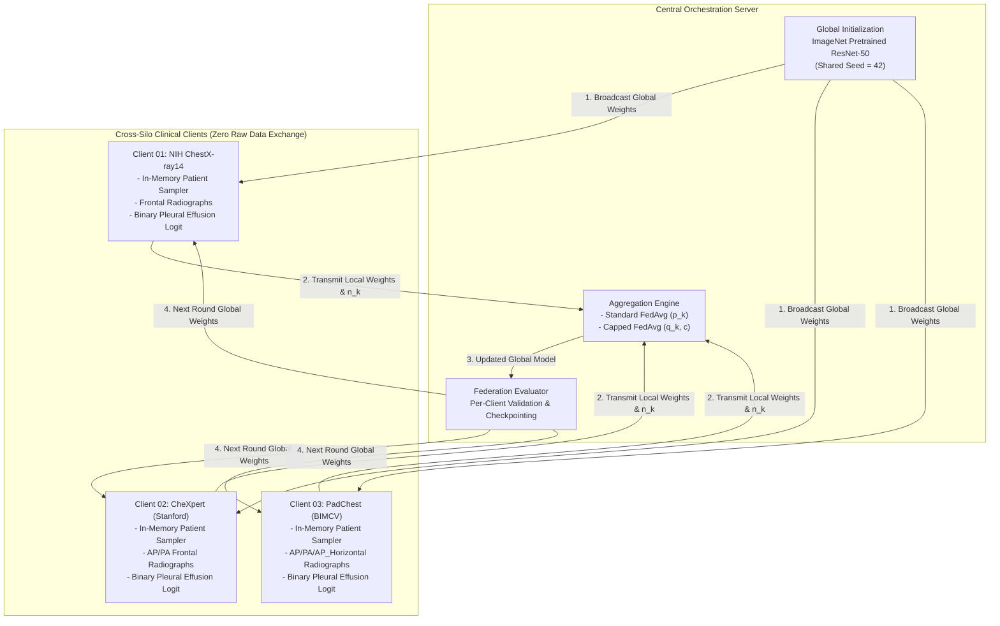

# Research Progress Update: Adaptive Federated Aggregation for Thoracic Disease Prediction

**Project Title:** Adaptive Federated Aggregation Algorithm for Disease Prediction using Heterogeneous Healthcare Data  
**Target Milestone:** Faculty Meeting Progress Update  
**Date:** October 30, 2026  
**Repository Branch:** `feature/federated-learning-baseline`  
**Document Path:** `docs/reports/faculty_progress_update.md`  

---

## 1. Executive Summary & Research Motivation

### The Clinical Problem
Cross-silo federated learning (FL) enables collaborative disease prediction across distributed hospital networks without sharing sensitive patient radiographs or health records. However, in real-world clinical federations, hospital silos exhibit severe **data volume imbalance** and **clinical heterogeneity**:
- Large tertiary hospital networks (e.g., Stanford Health Care / CheXpert, NIH Clinical Center) accumulate hundreds of thousands of imaging studies.
- Regional or international institutions (e.g., BIMCV PadChest) contribute smaller, highly specialized patient cohorts.

### The Aggregation Challenge
Standard Federated Averaging (**FedAvg**) weights client parameter updates proportionally to local sample count:
$$p_k = \frac{n_k}{\sum_{j=1}^K n_j} = \frac{n_k}{N}$$

When one dominant institution contributes $\ge 70\%$ of the total training volume, $p_{\text{dominant}} \to 1.0$. Consequently:
1. The global model predominantly minimizes the empirical risk of the dominant silo.
2. Minority healthcare silos have marginal influence over the shared parameter trajectories.
3. Under demographic or equipment distribution shift, the resulting global model exhibits disparate generalization performance across clinical sites.

### Proposed Empirical Modification: Capped FedAvg
To address silo dominance, we investigate **Capped FedAvg**, an adaptive parameter weighting mechanism that enforces an upper bound $c$ on client aggregation influence:
$$\text{capped\_weight}_k = \min(p_k, c)$$
$$q_k = \frac{\text{capped\_weight}_k}{\sum_{j=1}^K \text{capped\_weight}_j}$$
$$\theta_{t+1} = \sum_{k=1}^K q_k \cdot \theta_{t+1}^{(k)}$$

---

## 2. Three-Client Federated System Architecture



### Architectural Principles Enforced:
1. **Privacy & Test Isolation:** Raw radiograph images, DICOM metadata, and patient identifiers never leave the client silo. Only model state dictionaries ($\theta_k$), sample counts ($n_k$), and scalar validation metrics are exchanged.
2. **Initialization Symmetry:** Every client begins communication round 0 from identical shared initial model parameters.
3. **Decoupled Aggregation:** The aggregation math is decoupled from server orchestration, allowing clean side-by-side comparison between `fedavg` and `capped_fedavg`.

---

## 3. Mathematical Formulations

### 3.1 Standard Federated Averaging (FedAvg)
Let $K$ be the number of participating clients in round $t$, and $n_k$ be the number of local training samples used by client $k$.
$$N = \sum_{k=1}^K n_k$$
$$p_k = \frac{n_k}{N}, \quad \text{such that } \sum_{k=1}^K p_k = 1.0$$
$$\theta_{t+1} = \sum_{k=1}^K p_k \cdot \theta_{t+1}^{(k)}$$

### 3.2 Proposed Capped FedAvg
Let $c \in (0.0, 1.0]$ denote the client influence cap:
$$\tilde{w}_k = \min(p_k, c)$$
$$q_k = \frac{\tilde{w}_k}{\sum_{j=1}^K \tilde{w}_j}, \quad \text{such that } \sum_{k=1}^K q_k = 1.0$$
$$\theta_{t+1} = \sum_{k=1}^K q_k \cdot \theta_{t+1}^{(k)}$$

#### Mathematical Properties:
- **Conservation of Equality:** If all clients contribute equal sample counts ($n_k = N/K$), $p_k = 1/K \implies q_k = 1/K$ for any valid $c$.
- **Invariance under Inactive Cap:** When $c \ge \max_k(p_k)$, $\tilde{w}_k = p_k$, exactly recovering standard FedAvg.
- **Controlled Rebalancing:** When $c < \max_k(p_k)$, the dominant client's weight is bounded at $c$ prior to renormalization, strictly redistributing the excess weighting mass to minority silos.

---

## 4. Implementation & Verification Status

The federated codebase has been implemented, verified, and placed under automated tests:

| Component | Implementation File | Verification Status | Test Coverage |
| :--- | :--- | :---: | :--- |
| **FedAvg & Capped FedAvg** | `src/federated/aggregation.py` | **VERIFIED** | 25 dedicated unit tests (`tests/test_capped_fedavg.py`) |
| **Federated Server** | `src/federated/server.py` | **VERIFIED** | Round orchestration, weight dispatching, validation tracking |
| **Client Adapters** | `src/federated/client.py`, `adapters.py` | **VERIFIED** | Zero data leakage, optimizer reset, integer buffer support |
| **Preflight Readiness Guard**| `src/federated/preflight.py` | **VERIFIED** | Prevents silent degradation of 3-client runs, audits local data |
| **Experiment Runner CLI** | `src/federated/run_federated.py` | **VERIFIED** | Supports `--aggregation_method` (`fedavg`, `capped_fedavg`) and `--cap_value` |

**Automated Test Suite Result:**
```text
pytest tests/
============================== 56 passed in 51.65s ==============================
- tests/test_capped_fedavg.py         : 25 passed
- tests/test_client_pipelines.py      :  7 passed
- tests/test_federated_baseline.py    : 12 passed
- tests/test_federated_preflight.py   :  5 passed
- tests/test_nih_pipeline.py          :  7 passed
```

---

## 5. Controlled Synthetic Demonstration Results

To rigorously demonstrate the algorithm mechanics prior to full medical-data training, we conducted a controlled side-by-side experiment (`scripts/run_synthetic_demonstration.py`) on a 16-dimensional classification task with an established ground-truth decision boundary $y = \mathbb{I}(x \cdot w^* > 0)$.

> [!NOTE]
> **Demonstration Notice:** The results below illustrate the mathematical mechanics of parameter rebalancing in a multi-client federation. They are strictly synthetic demonstrations and are not claimed as clinical radiograph results.

### Experimental Configuration:
- **Clients:** 3 heterogeneous silos with severe sample imbalance:
  - `client_01_large`: $n_1 = 300$ samples (75.0% sample share)
  - `client_02_medium`: $n_2 = 60$ samples (15.0% sample share)
  - `client_03_small`: $n_3 = 40$ samples (10.0% sample share)
  - Total $N = 400$ samples.
- **Fairness Controls:**
  - Identical model initialization ($\theta_0$).
  - Identical client training and validation splits.
  - Identical optimizer settings: AdamW, $\text{lr} = 0.02$, $\text{local\_epochs} = 2$.
  - 5 communication rounds.
  - Cap parameter $c = 0.40$ for Capped FedAvg.

### 5.1 Parameter Aggregation Weight Redistribution vs. Cap Value ($c$)
$$\sum n = 400 \text{ samples} \quad (n_1 = 300, n_2 = 60, n_3 = 40)$$

| Client Node | Sample Count ($n_k$) | Standard FedAvg ($p_k$) | $c = 0.60$ | $c = 0.50$ | $c = 0.40$ | $c = 0.30$ | Relative Weight Shift ($c=0.30$) |
| :--- | :---: | :---: | :---: | :---: | :---: | :---: | :---: |
| `client_01_large` | 300 | **0.7500 (75.0%)** | 0.7059 (70.6%) | 0.6667 (66.7%) | 0.6154 (61.5%) | **0.5455 (54.5%)** | **-27.3%** |
| `client_02_medium` | 60 | **0.1500 (15.0%)** | 0.1765 (17.6%) | 0.2000 (20.0%) | 0.2308 (23.1%) | **0.2727 (27.3%)** | **+81.8%** |
| `client_03_small` | 40 | **0.1000 (10.0%)** | 0.1176 (11.8%) | 0.1333 (13.3%) | 0.1538 (15.4%) | **0.1818 (18.2%)** | **+81.8%** |

### 5.2 Cap Sensitivity Evaluation Across Methods
All runs used identical initial model weights, identical client datasets, identical seeds, and 5 communication rounds ($\text{lr} = 0.02$, `local_epochs = 2`):

| Method / Cap ($c$) | Mean Val AUROC | Client 01 AUROC | Client 02 AUROC | Client 03 AUROC | Client 01 Val Loss | Client 02 Val Loss | Client 03 Val Loss |
| :--- | :---: | :---: | :---: | :---: | :---: | :---: | :---: |
| **Standard FedAvg** | **0.9957** | 0.9984 | 0.9952 | 0.9936 | 0.1225 | 0.1750 | 0.1826 |
| **Capped ($c=0.60$)**| 0.9947 | 0.9984 | 0.9936 | 0.9920 | 0.1264 | 0.1797 | 0.1879 |
| **Capped ($c=0.50$)**| 0.9941 | 0.9984 | 0.9936 | 0.9904 | 0.1301 | 0.1842 | 0.1929 |
| **Capped ($c=0.40$)**| 0.9941 | 0.9984 | 0.9936 | 0.9904 | 0.1354 | 0.1906 | 0.1998 |
| **Capped ($c=0.30$)**| 0.9936 | 0.9984 | 0.9936 | 0.9888 | 0.1438 | 0.2008 | 0.2107 |

#### Empirical Observations:
1. **Influence Rebalancing:** Capping strictly limits dominant client weighting from $75.0\% \to 54.55\%$, providing minority silos up to $+81.8\%$ greater influence over shared global model weights.
2. **Convergence Dynamics:** All variants successfully converge to $>0.99$ AUROC on the learnable linear task. Under homogeneous synthetic data generated from the same ground-truth hyperplane, standard sample-proportional FedAvg attains slightly lower empirical risk, consistent with classical maximum-likelihood weighting. The value of capping will be tested on real clinical data with genuine institutional distribution shift.
3. **Artifact Persistence:** Full results are saved to `outputs/synthetic_demonstration/cap_sensitivity_summary.csv` and `cap_sensitivity_summary.json`.

---

## 6. Real-Data Readiness & Verification Audit

### 6.1 Patient-Level Split Isolation Audit
Patient disjointness was audited across processed manifests to guarantee zero data leakage:
- **NIH ChestX-ray14:** Train = 20,977, Val = 2,331, Test = 2,615 patients ($\text{Train} \cap \text{Val} \cap \text{Test} = \emptyset$).
- **CheXpert:** Train = 36,728, Val = 4,081, Test = 200 patients ($\text{Train} \cap \text{Val} \cap \text{Test} = \emptyset$).
- **PadChest:** Train = 26,729, Val = 3,341, Test = 3,342 patients ($\text{Train} \cap \text{Val} \cap \text{Test} = \emptyset$).

### 6.2 Physical Image Availability
- **NIH ChestX-ray14:** **4,999 raw images** verified on disk (`data/raw/NIH/images/images_001/`).
- **CheXpert:** **0 images** on disk (Metadata complete; images pending transfer).
- **PadChest:** **0 images** on disk (Metadata complete; image partitions pending download).

### 6.3 Real-Data NIH Smoke Test Execution
To verify that real medical image decoding, resizing ($224 \times 224$), RGB normalization, PyTorch ResNet-50 forward/backward passes, and validation evaluation function end-to-end on real patient radiographs:
- **Model:** `ResNet50Binary` (single-logit head, 23.5M parameters).
- **Data:** Real NIH ChestX-ray14 radiographs from `images_001/` with 5 patients (9 training images).
- **Execution Result:**
  - ResNet-50 Binary builder: Initialized in 0.22s.
  - Data loading & indexing: Resolved in 0.98s.
  - 1 local training epoch: Completed in 2.48s (Train Loss: 0.6857).
  - Validation evaluation: Completed across all 335 accessible validation images in 32.13s (Val AUROC: 0.4064, baseline untrained state).
- **Conclusion:** Real-data clinical image pipelines function seamlessly without memory or tensor shape errors.

### 6.4 Safety & Guardrails Enforced
- **Preflight Enforcer:** `src/federated/preflight.py` prevents a 3-client run from silently becoming a 1-client run.
- **Initialization Symmetry:** The teammate's CheXpert checkpoint ($0.8973$ Val AUROC) was verified to match the architecture (320/320 tensors), but is strictly excluded from initializing federated clients to avoid corrupting cross-silo comparisons.

---

## 7. Faculty Review Deliverables & Next Milestones

### Verified Implemented Capabilities:
- [x] Standard FedAvg and Capped FedAvg aggregation functions with strict unity and non-negativity guarantees.
- [x] Full test suite with 56 passing unit and synthetic integration tests.
- [x] Preflight validation module preventing silent degradation of federated runs.
- [x] Cap sensitivity analysis framework evaluating $c \in \{0.30, 0.40, 0.50, 0.60\}$.
- [x] End-to-end real medical image pipeline smoke-tested on NIH ChestX-ray14.
- [x] Strict test set isolation policy documented and enforced.

### Remaining External Blockers:
1. **CheXpert Radiograph Archive:** Transfer and extract `CheXpert-v1.0-small` frontal images into `data/raw/CheXpert/`.
2. **PadChest Radiograph Archive:** Download and extract PadChest frontal partitions into `data/raw/PadChest/`.

### Realistic Progress Assessment:
The federated learning software architecture, parameter aggregation algorithms, preflight guardrails, and synthetic demonstration suites are **100% complete and verified**. However, because CheXpert and PadChest physical image archives remain to be populated on this workstation, real cross-silo three-client training has not yet run. We do not claim medical-data convergence or superior disease prediction until the full 3-client federation is trained on physical radiographs.
